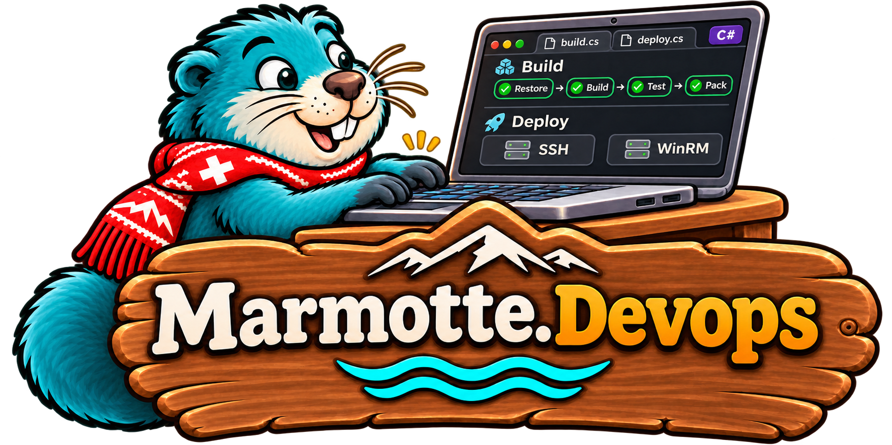

# Marmotte.Devops



A minimalist C# toolkit for scripting builds and deployments with .NET file-based apps.

Marmotte.Devops is the repository and solution name. Build and Deploy have separate responsibilities: **Build** compiles, tests, and packages applications; **Deploy** handles remote execution and delivery to target machines.

Write your automation as C# files, compose paths with `/`, find files with globs, and run commands with explicit results. Steps follow normal C# control flow: variables, functions, loops, and pattern matching.

## Build and Deploy

| Component | Responsibility | Entry point |
| --- | --- | --- |
| [Marmotte.Build](src/Marmotte.Build) | Build orchestration, .NET CLI commands, paths, processes, Git, and CI variables. | [build.cs](build.cs) and the [build scripting guide](#write-a-build-script). |
| [Marmotte.Deploy](src/Marmotte.Deploy) | Shared deployment project, currently a scaffold. | Deployment APIs are still being developed. |
| [Marmotte.Deploy.Windows](src/Marmotte.Deploy.Windows) | Experimental Windows deployment through PowerShell Remoting / WinRM. | [deploy.cs](deploy.cs) and the [Windows remoting guide](docs/windows-remoting-poc.md). |
| SSH deployment script | Experimental cross-platform remote commands and file transfers using OpenSSH and Marmotte.Build's process helpers. | [deploy-ssh.cs](deploy-ssh.cs) and the [SSH deployment guide](docs/ssh-deploy.md). |

The solution is [Marmotte.Devops.slnx](Marmotte.Devops.slnx). The build library and its NuGet package retain the name `Marmotte.Build`.

## Project status

> **Experimental proof of concept — not production-ready.**
> The API is still evolving and may change without compatibility guarantees.


The `Marmotte.Build` library currently provides the following building blocks:

| API | Purpose |
| --- | --- |
| `GitHubActions` | Read GitHub Actions and runner variables with IDE completion. |
| `PathInfo` | Compose paths, check files and directories, and enumerate glob matches. |
| `Shell` | Run an executable synchronously, with separate arguments and an optional working directory. |
| `Dotnet` | Call the .NET CLI through small wrappers such as `Build`, `Test`, and `Pack`. |
| `Git` | Read the branch, commits and tags of a repository, then stage, commit and tag, with LibGit2Sharp. |
| `AzureDevOps` | Read predefined Azure Pipelines variables with IDE completion. |
| `Targets` | Declare named targets with dependencies and conditions, then run one from the command line. |

Targets are optional: a script can also run its steps with plain C# control flow. Targets run one after another; there is no parallel execution or incremental build engine.

## Prerequisites

- **.NET 11 SDK**: the projects currently target `net11.0`, and `Shell` uses C# union types.
- Any executable invoked by your script must be available on `PATH`, or supplied by path.
- NuGet access for the initial dependency restore.

[Directory.Build.props](Directory.Build.props) defines the target framework and language version. [global.json](global.json) selects Microsoft.Testing.Platform for tests; it does not pin an SDK version.

## Build Marmotte.Devops and publish Marmotte.Build

From the repository root:

```sh
dotnet run --file build.cs
```

The checked-in [build.cs](build.cs) uses Marmotte.Build's own sources through `#:include`, so it does not depend on an already published Marmotte.Build package. It declares the `Clean`, `Restore`, `Build`, `Test`, `Pack` and `Publish` targets, and runs `Publish` with its dependencies by default: it cleans, restores and builds the solution in Release, runs the tests, then packs the library into `artefacts/nugets`. Each target must succeed before the next one runs. The `Clean` target recreates the package output directory to avoid publishing stale packages. `Publish` only pushes packages when `--publish` is given; otherwise it is skipped.

To run a single target with its dependencies, pass its name:

```sh
dotnet run --file build.cs -- --target Build
```

To print the dependency tree and execution order without running anything, add `--plan`:

```sh
dotnet run --file build.cs -- --plan
```

To also publish to `https://nuget.pkg.github.com/rflechner/index.json`, set `GITHUB_TOKEN` in your environment, then run:

```sh
dotnet run --file build.cs -- --publish
```

For local publishing, use a GitHub personal access token (classic) with `write:packages`. In GitHub Actions, expose `${{ secrets.GITHUB_TOKEN }}` as the `GITHUB_TOKEN` environment variable and grant the job `packages: write` (and `contents: read` for checkout). See [GitHub's NuGet registry documentation](https://docs.github.com/en/packages/working-with-a-github-packages-registry/working-with-the-nuget-registry).

The script passes the token through `NUGET_API_KEY`, supported by the NuGet CLI in .NET 11, without adding it to command arguments, logs or configuration files. See [NuGet API key environment variables](https://learn.microsoft.com/en-us/nuget/reference/nuget-config-file#apikeys).

The script reads the version from `GitHubActions.RefName` when `GitHubActions.RefType` is `tag`, removing an optional leading `v`. Otherwise, the version defaults to [Directory.Build.props](Directory.Build.props). An explicit `--version` takes precedence over both for the build and package:

```sh
dotnet run --file build.cs -- --publish --version 0.1.1
```

Omit `--publish` to validate and pack that version locally. Publishing requires `GITHUB_TOKEN`; existing package versions are skipped with `--skip-duplicate`, so increment the version to release changes. The package's repository metadata links it to `rflechner/Marmotte.Devops` on GitHub. The script builds and tests the solution, then packs and publishes only `Marmotte.Build`; the deployment projects are not published by this workflow.

### Publish from a Git tag

The [Publish NuGet package workflow](.github/workflows/publish-nuget.yml) runs when a new tag is pushed. It installs .NET 11 and runs `dotnet run --file build.cs -- --publish`; `build.cs` reads the tag directly through Marmotte.Build's `GitHubActions` helper. For example, `v0.1.1` and `0.1.1` both publish version `0.1.1`, while `v0.2.0-preview.1` publishes `0.2.0-preview.1`. Tags must contain a valid NuGet version; invalid versions fail the build instead of publishing the default version. Updating or deleting an existing tag does not publish a package.

The workflow uses the automatic `GITHUB_TOKEN` with `contents: read` and `packages: write`; no personal access token secret is needed. Create the tag on a commit containing the workflow and updated build script, then push it:

```sh
git tag v0.1.1
git push origin v0.1.1
```

## Write a build script

The following example references the local build project. Save it as `build-pipeline.cs` at the repository root, then run it from that directory. The `#:project` directive makes the library and its dependencies available to the file-based app without a published package.

```csharp
#!/usr/bin/env dotnet
#:project src/Marmotte.Build/Marmotte.Build.csproj
#:property PublishAot=false

using Marmotte.Build;
using static Marmotte.Build.Shell;

PathInfo root = PathInfo.CurrentDirectory;
var configuration = args.Length > 0 ? args[0] : "Release";

foreach (var project in (root / "src" / "**" / "*.csproj").GetChildren())
    Console.WriteLine($"Project: {project}");

var buildExitCode = GetExitCode(Dotnet.Build(o => o with
    {
        Project = root / "Marmotte.Devops.slnx",
        Configuration = configuration,
    },
    workingDirectory: root));

if (buildExitCode != 0)
    return buildExitCode;

return GetExitCode(Dotnet.Test(o => o with
    {
        Solution = root / "Marmotte.Devops.slnx",
        Configuration = configuration,
        NoBuild = true,
    },
    workingDirectory: root));

static int GetExitCode(ShellExecuteResult result)
{
    switch (result.Value)
    {
        case ShellExecuteSuccess:
            return 0;
        case ShellExecuteFailure failure:
            return failure.ExitCode;
        case ShellExecuteNotStarted notStarted:
            Console.Error.WriteLine($"Could not start {notStarted.Command}: {notStarted.Reason}");
            return 1;
        default:
            throw new InvalidOperationException("Unexpected command result.");
    }
}
```

```sh
dotnet run --file build-pipeline.cs
dotnet run --file build-pipeline.cs -- Debug
```

The script builds the solution, runs tests only after a successful build, and returns a non-zero exit code on failure. Command failures are returned as values; ignoring a result does not automatically stop the script.

## Declare targets

Declare each step as a target, list the targets it depends on, then run one of them:

```csharp
using static Marmotte.Build.Targets;

var shouldDeploy = args.Contains("--deploy");

Target("Clean", () => Dotnet.Clean());
Target("Restore", () => Dotnet.Restore());
Target("Build", ["Clean", "Restore"], () => Dotnet.Build(o => o with { NoRestore = true }));
Target("Test", ["Build"], () => Dotnet.Test(o => o with { NoBuild = true }));
Target("Deploy", ["Test"], () => Console.WriteLine("Deploying..."), when: () => shouldDeploy);
Target("All", ["Deploy"]);

return RunTarget(args, defaultTarget: "All");
```

```sh
dotnet run --file build-pipeline.cs                    # runs All
dotnet run --file build-pipeline.cs -- --target Build  # runs Clean, Restore, Build
dotnet run --file build-pipeline.cs -- --deploy        # also runs Deploy
dotnet run --file build-pipeline.cs -- --plan          # prints the plan of All, runs nothing
```

`--plan` prints the dependency tree of the selected target, marks targets that have a `when` condition, and lists the execution order:

```text
All
└── Deploy (conditional)
    └── Test
        └── Build
            ├── Clean
            └── Restore
Execution order: Clean, Restore, Build, Test, Deploy, All
```

A target shared by several targets appears under each of them in the tree, but runs once.

| Feature | Behavior |
| --- | --- |
| Dependencies | Named by target, in any case, and declared in any order. They run depth first, in the order given, before the target. A target reached through several paths runs once. |
| Actions | An `Action` fails the build by throwing. A lambda returning `ShellExecuteResult` fails the build when the command fails or cannot start. A target without an action only groups its dependencies. |
| `when` | Evaluated right before the target runs, after its dependencies. When it returns `false`, the target is skipped, but its dependencies still run. |
| `RunTarget(args, defaultTarget)` | Runs the target named by `--target <name>` (case-insensitive), or `defaultTarget`. With `--plan`, prints the plan instead of running it. Other arguments are ignored. Returns `0` on success and `1` on failure or unknown target, ready to `return` from the script. |

Before running anything, or printing the plan, `RunTarget` checks every declared target, not only the selected one. It reports duplicate names (ignoring case), dependencies on undeclared targets and dependency cycles together, then returns `1`:

```text
Invalid targets:
  - Target Deploy depends on unknown target Tset.
  - Dependency cycle: Build -> Test -> Build.
```

Once the build has started, the first failure stops it and prints the exception.

## Read GitHub Actions variables

In a file-based build script, include the helper and type `GitHubActions.` to browse workflow variables or `GitHubActions.Runner.` for runner details.

```csharp
#!/usr/bin/env dotnet
#:include "src/Marmotte.Build/ContinuousIntegration/GitHubActions.cs"

using Marmotte.Build.ContinuousIntegration;

if (GitHubActions.IsRunning)
    Console.WriteLine($"{GitHubActions.Repository} run #{GitHubActions.RunNumber} on {GitHubActions.Runner.OS}");

if (GitHubActions.HeadRef is { Length: > 0 } source && GitHubActions.BaseRef is { Length: > 0 } target)
    Console.WriteLine($"Validating {source} into {target}");
```

Each string property reads the current environment value and returns `null` if the variable is absent. `IsRunning` checks `GITHUB_ACTIONS`. Use `GitHubActions.GetVariable("BUILD_CONFIGURATION")` for a custom name exported through the workflow's `env`. The [GitHub Actions variables reference](https://docs.github.com/en/actions/reference/workflows-and-actions/variables#default-environment-variables) lists the defaults and when they are available.

## Paths and globs

```csharp
PathInfo root = PathInfo.CurrentDirectory;
PathInfo source = root / "src";
PathInfo project = source / "Marmotte.Build" / "Marmotte.Build.csproj";

Console.WriteLine(project.IsFile);

foreach (var file in (source / "**" / "*.cs").GetChildren())
    Console.WriteLine(file);
```

`PathInfo` converts implicitly to and from `string`. It normalizes the platform's alternate directory separator and trims a trailing separator, preserving filesystem roots. Combining paths follows `Path.Combine`: a rooted right-hand operand replaces the left-hand path.

| Pattern | Matches |
| --- | --- |
| `src / "*.cs"` | C# files directly under `src`. |
| `src / "?est.cs"` | Names with exactly one character before `est.cs`. |
| `src / "*" / "*.csproj"` | Project files one directory below `src`. |
| `src / "**" / "*.cs"` | C# files at any depth under `src`, including directly inside it. |
| `src / "**"` | All descendant files and directories. |

Here, `src` represents a `PathInfo` variable. `GetChildren()` enumerates lazily, returns direct children for an ordinary directory, and returns no entries for a file or a missing path. Results include files and directories where the pattern permits, include hidden entries, and have no guaranteed order. Relative patterns produce relative paths. Wildcard matching uses the platform's default case sensitivity.

## Run commands

```csharp
var version = Shell.Execute("dotnet", "--version");

var build = Shell.Execute(
    "dotnet",
    ["build", "My Project.csproj", "--configuration", "Release"],
    workingDirectory: PathInfo.CurrentDirectory / "src");
```

Each argument is passed separately, so a path containing spaces remains one argument. `Shell.Execute` starts the executable directly: shell operators such as `|`, `&&`, and `>` are not interpreted. Output goes to the current console; the API does not capture stdout or stderr.

Both `Shell` and `Dotnet` return `Shell.ShellExecuteResult`. Inspect its `.Value` with pattern matching:

| Result | Meaning |
| --- | --- |
| `ShellExecuteSuccess` | The process exited with code `0`. |
| `ShellExecuteFailure` | The process exited with a non-zero `ExitCode`. |
| `ShellExecuteNotStarted` | The process could not start; `Command` and `Reason` describe the problem. This also covers a missing working directory. |

Execution waits for the process to exit. Cancellation, timeouts, asynchronous execution, and output capture are not currently exposed.

## Use the .NET CLI

```csharp
var build = Dotnet.Build(o => o with { Configuration = "Release" });
var pack = Dotnet.Pack(o => o with { Configuration = "Release", Output = "artifacts" });
var tools = Dotnet.Tool.Restore();
var info = Dotnet.Execute("--info");
```

These are independent examples; handle each result when composing a pipeline. Wrappers accept typed options and an optional `workingDirectory`; commands with required arguments take them before the options callback. Unset options use the installed .NET CLI's defaults. Use `AdditionalArguments` for options without a dedicated property, or `Dotnet.Execute` for raw commands and global options. See the [Dotnet API](src/Marmotte.Build/Dotnet) for the wrappers and the [generator guide](tools/generate-dotnet/README.md) for how they are maintained.

## Read and update the Git repository

`Git` uses [LibGit2Sharp](https://github.com/libgit2/libgit2sharp), so it does not need the `git` executable. In a file-based build script, reference the package and include the helper:

```csharp
#!/usr/bin/env dotnet
#:package LibGit2Sharp@0.32.0
#:include "src/Marmotte.Build/PathInfo.cs"
#:include "src/Marmotte.Build/VersionControl/Git.cs"

using Marmotte.Build;
using Marmotte.Build.VersionControl;

using var git = Git.Open(PathInfo.CurrentDirectory);

Console.WriteLine($"{git.Branch ?? "detached HEAD"} at {git.Head.ShortSha} ({git.Describe()})");

if (git.LatestTag is { } tag)
    Console.WriteLine($"Latest tag: {tag.Name}");

if (git.IsDirty)
{
    git.StageAll();
    git.Commit("chore: update generated files");
}

git.CreateTag("v1.2.3", message: "Release 1.2.3");
```

In a repository that manages package versions centrally, such as this one, omit the version from the directive (`#:package LibGit2Sharp`): .NET rejects a version there and uses `Directory.Packages.props` instead.

Open the repository once and dispose it at the end of the script. Properties read the repository on each access, so they reflect the commits and tags created in the meantime.

| Member | Behavior |
| --- | --- |
| `Git.Open(path)` | Opens the repository containing `path`, or the current directory, searching parent directories. Fails outside a repository. |
| `RootDirectory` | The root of the working directory. |
| `Branch` | The checked-out branch, or `null` when HEAD is detached, as in many CI builds of tags and pull requests. |
| `Head` | The HEAD commit: `Sha`, `ShortSha`, `Message`, `MessageShort`, author and date. Fails before the first commit. |
| `IsDirty` | `true` when staged, modified or untracked files differ from HEAD. Ignored files do not count. |
| `Tags`, `TagsAtHead` | All tags, or the tags on HEAD, sorted by name. A tag's `Sha` is the commit it points to, even for an annotated tag. |
| `LatestTag` | The tag on the closest commit reachable from HEAD, or `null`. When several tags share that commit, the first by name wins. |
| `Describe()` | Like `git describe --tags`: `v1.2.3`, `v1.2.3-4-gabc1234`, or the short commit identifier when no tag is reachable. |
| `Stage(paths)`, `StageAll()` | Like `git add`, including deleted files. Paths are relative to `RootDirectory` or absolute, and accept patterns such as `src/*.cs`. |
| `Commit(message, author)` | Commits the staged changes and returns the new HEAD. Without `author`, uses `user.name` and `user.email` from the Git configuration. Fails when nothing is staged. |
| `CreateTag(name, message, tagger)` | Tags HEAD: a lightweight tag without `message`, an annotated tag with it. Fails when the tag already exists. |
| `Repository` | The LibGit2Sharp `Repository`, for anything else. |

CI runners usually have no Git identity: pass one, such as `git.Commit("chore: bump version", new GitIdentity("Build Bot", "bot@example.com"))`. By default, `actions/checkout` fetches a single commit without tags; set `fetch-depth: 0` so `LatestTag` and `Describe()` can find them.

Pushing and fetching are not wrapped: they need credentials, and LibGit2Sharp does not support SSH remotes. Run the Git CLI instead:

```csharp
Shell.Execute("git", ["push", "origin", "v1.2.3"], workingDirectory: git.RootDirectory).ThrowIfNotFailed();
```

## Read Azure Pipelines variables

Include the helper in a file-based build script and type `AzureDevOps.Build.` in your IDE to browse build variables. The groups follow Azure Pipelines naming, including `Agent`, `System.PullRequest`, and `Release`.

```csharp
#!/usr/bin/env dotnet
#:include "src/Marmotte.Build/ContinuousIntegration/AzureDevOps.cs"

using Marmotte.Build.ContinuousIntegration;

if (AzureDevOps.IsRunning)
    Console.WriteLine($"Build {AzureDevOps.Build.BuildNumber} on {AzureDevOps.Build.SourceBranch}");

if (AzureDevOps.System.PullRequest.TargetBranch is { } target)
    Console.WriteLine($"Validating a pull request into {target}");
```

Each property reads a nullable string from the current process environment. A local run or a job outside a variable's scope gets `null` when the variable is absent. For names that depend on your pipeline, use `AzureDevOps.GetVariable("resources.pipeline.upstream.runID")` with your resource alias.

To read `AzureDevOps.System.AccessToken` in a YAML step, explicitly map `SYSTEM_ACCESSTOKEN: $(System.AccessToken)` under the step's `env`. See the [predefined build variables](https://learn.microsoft.com/en-us/azure/devops/pipelines/build/variables?view=azure-devops), [classic release variables](https://learn.microsoft.com/en-us/azure/devops/pipelines/release/variables?view=azure-devops), and [pipeline resource variables](https://learn.microsoft.com/en-us/azure/devops/pipelines/yaml-schema/resources-pipelines-pipeline?view=azure-pipelines).

## Deploy

Deployment is a separate part of Marmotte.Devops. The current examples validate remote connectivity and file access; they do not yet implement a complete application deployment or rollback workflow.

| Transport | Script | Guide |
| --- | --- | --- |
| OpenSSH (`ssh` / `scp`) on Windows, Linux, and macOS | [deploy-ssh.cs](deploy-ssh.cs) | [SSH setup and smoke test](docs/ssh-deploy.md) |
| PowerShell Remoting / WinRM from Windows | [deploy.cs](deploy.cs), using `Marmotte.Deploy.Windows` | [Windows remoting setup and smoke test](docs/windows-remoting-poc.md) |

Follow the relevant guide to configure a target before running a deployment script. These smoke tests are independent of `build.cs` and are not run by the normal build, test, or package workflow.

## Build and test the solution

From the repository root:

```sh
dotnet restore Marmotte.Devops.slnx
dotnet build Marmotte.Devops.slnx --configuration Release --no-restore
dotnet test --solution Marmotte.Devops.slnx --configuration Release --no-build --no-restore
```

The tests cover path composition and normalization, glob matching, process results, argument handling, working directories, .NET command execution, and Git operations on temporary repositories. Some process tests intentionally invoke failing commands, so their console output includes expected errors. Two tests use the Unix `test` executable and are skipped on Windows.

## Mascot and license

Marmotte.Devops shares the turquoise mascot and red scarf used by [Marmotte.ChatUi](https://github.com/rflechner/Marmotte.ChatUi). Its banner shows the mascot at a laptop with separate Build and Deploy workflows above the Marmotte.Devops sign. A matching [logo](docs/images/marmotte-devops-logo.png) is available for reuse. All images are stored locally; see [image provenance](docs/images/README.md).

Licensed under the [BSD 3-Clause License](LICENSE).
