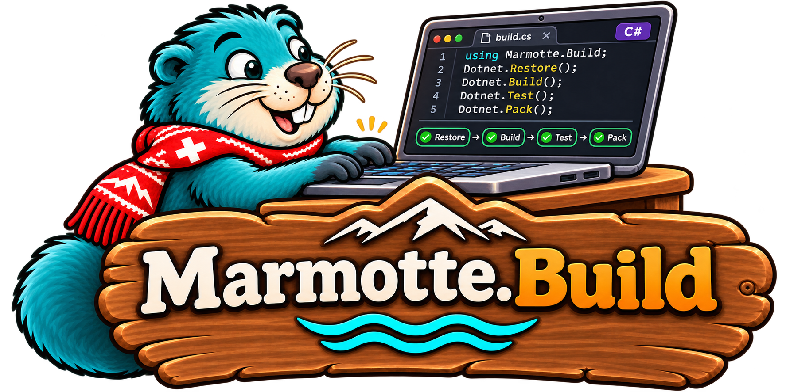

# Marmotte.Build



A minimalist C# DSL for scripting builds with .NET file-based apps.

Write your build as a C# file, compose paths with `/`, find files with globs, and run commands with explicit results. Build steps follow normal C# control flow: variables, functions, loops, and pattern matching.

## Project status

> **Experimental proof of concept — not production-ready.**
> The API is still evolving and may change without compatibility guarantees.


The current implementation provides the following building blocks:

| API | Purpose |
| --- | --- |
| `GitHubActions` | Read GitHub Actions and runner variables with IDE completion. |
| `PathInfo` | Compose paths, check files and directories, and enumerate glob matches. |
| `Shell` | Run an executable synchronously, with separate arguments and an optional working directory. |
| `Dotnet` | Call the .NET CLI through small wrappers such as `Build`, `Test`, and `Pack`. |
| `AzureDevOps` | Read predefined Azure Pipelines variables with IDE completion. |

Your script controls execution order and decides how to handle failures. There is no task graph, dependency scheduler, or incremental build engine in Marmotte.Build itself.

## Prerequisites

- **.NET 11 SDK**: the projects currently target `net11.0`, and `Shell` uses C# union types.
- Any executable invoked by your script must be available on `PATH`, or supplied by path.
- NuGet access for the initial dependency restore.

[Directory.Build.props](Directory.Build.props) defines the target framework and language version. [global.json](global.json) selects Microsoft.Testing.Platform for tests; it does not pin an SDK version.

## Build and publish Marmotte.Build

From the repository root:

```sh
dotnet run --file build.cs
```

The checked-in [build.cs](build.cs) uses Marmotte.Build's own sources through `#:include`, so it does not depend on an already published Marmotte.Build package. It cleans, restores and builds the solution in Release, runs the tests, then packs the library into `artefacts/nugets`. Each command must succeed before the next one runs. The package output directory is recreated on each run to avoid publishing stale packages.

To also publish to `https://nuget.pkg.github.com/rflechner/index.json`, set `GITHUB_TOKEN` in your environment, then run:

```sh
dotnet run --file build.cs -- --publish
```

For local publishing, use a GitHub personal access token (classic) with `write:packages`. In GitHub Actions, expose `${{ secrets.GITHUB_TOKEN }}` as the `GITHUB_TOKEN` environment variable and grant the job `packages: write` (and `contents: read` for checkout). See [GitHub's NuGet registry documentation](https://docs.github.com/en/packages/working-with-a-github-packages-registry/working-with-the-nuget-registry).

The script passes the token through `NUGET_API_KEY`, supported by the NuGet CLI in .NET 11, without adding it to command arguments, logs or configuration files. See [NuGet API key environment variables](https://learn.microsoft.com/en-us/nuget/reference/nuget-config-file#apikeys).

The script reads the version from `GitHubActions.RefName` when `GitHubActions.RefType` is `tag`, removing an optional leading `v`. Otherwise, the version defaults to [Directory.Build.props](Directory.Build.props). An explicit `--version` takes precedence over both for the build and package:

```sh
dotnet run --file build.cs -- --publish --version 0.1.1
```

Omit `--publish` to validate and pack that version locally. Publishing requires `GITHUB_TOKEN` before any build step starts; existing package versions are skipped with `--skip-duplicate`, so increment the version to release changes. The package's repository metadata links it to `rflechner/Marmotte.Build` on GitHub.

### Publish from a Git tag

The [Publish NuGet package workflow](.github/workflows/publish-nuget.yml) runs when a new tag is pushed. It installs .NET 11 and runs `dotnet run --file build.cs -- --publish`; `build.cs` reads the tag directly through Marmotte.Build's `GitHubActions` helper. For example, `v0.1.1` and `0.1.1` both publish version `0.1.1`, while `v0.2.0-preview.1` publishes `0.2.0-preview.1`. Tags must contain a valid NuGet version; invalid versions fail the build instead of publishing the default version. Updating or deleting an existing tag does not publish a package.

The workflow uses the automatic `GITHUB_TOKEN` with `contents: read` and `packages: write`; no personal access token secret is needed. Create the tag on a commit containing the workflow and updated build script, then push it:

```sh
git tag v0.1.1
git push origin v0.1.1
```

## Write a build script

The following example uses the sources directly. Save it as `build-pipeline.cs` at the repository root, then run it from that directory. The `#:include` directives bring the three building blocks into the file-based app without a separate script project.

```csharp
#!/usr/bin/env dotnet
#:include "src/Marmotte.Build/PathInfo.cs"
#:include "src/Marmotte.Build/Shell.cs"
#:include "src/Marmotte.Build/Dotnet.cs"

using Marmotte.Build;
using static Marmotte.Build.Shell;

PathInfo root = PathInfo.CurrentDirectory;
var configuration = args.Length > 0 ? args[0] : "Release";

foreach (var project in (root / "src" / "**" / "*.csproj").GetChildren())
    Console.WriteLine($"Project: {project}");

var buildExitCode = GetExitCode(Dotnet.Build(
    ["Marmotte.Build.slnx", "--configuration", configuration],
    workingDirectory: root));

if (buildExitCode != 0)
    return buildExitCode;

return GetExitCode(Dotnet.Test(
    ["--solution", "Marmotte.Build.slnx", "--configuration", configuration, "--no-build"],
    workingDirectory: root));

static int GetExitCode(ShellExecuteResult result)
{
    switch (result.Value)
    {
        case ShellExecuteSuccess:
            return 0;
        case ShellExecuteFailure failure:
            return failure.ExitCode;
        case ShellExecuteNotStarted notStarted:
            Console.Error.WriteLine($"Could not start {notStarted.Command}: {notStarted.Reason}");
            return 1;
        default:
            throw new InvalidOperationException("Unexpected command result.");
    }
}
```

```sh
dotnet run --file build-pipeline.cs
dotnet run --file build-pipeline.cs -- Debug
```

The script builds the solution, runs tests only after a successful build, and returns a non-zero exit code on failure. Command failures are returned as values; ignoring a result does not automatically stop the script.

## Read GitHub Actions variables

In a file-based build script, include the helper and type `GitHubActions.` to browse workflow variables or `GitHubActions.Runner.` for runner details.

```csharp
#!/usr/bin/env dotnet
#:include "src/Marmotte.Build/GitHubActions.cs"

using Marmotte.Build;

if (GitHubActions.IsRunning)
    Console.WriteLine($"{GitHubActions.Repository} run #{GitHubActions.RunNumber} on {GitHubActions.Runner.OS}");

if (GitHubActions.HeadRef is { Length: > 0 } source && GitHubActions.BaseRef is { Length: > 0 } target)
    Console.WriteLine($"Validating {source} into {target}");
```

Each string property reads the current environment value and returns `null` if the variable is absent. `IsRunning` checks `GITHUB_ACTIONS`. Use `GitHubActions.GetVariable("BUILD_CONFIGURATION")` for a custom name exported through the workflow's `env`. The [GitHub Actions variables reference](https://docs.github.com/en/actions/reference/workflows-and-actions/variables#default-environment-variables) lists the defaults and when they are available.

## Paths and globs

```csharp
PathInfo root = PathInfo.CurrentDirectory;
PathInfo source = root / "src";
PathInfo project = source / "Marmotte.Build" / "Marmotte.Build.csproj";

Console.WriteLine(project.IsFile);

foreach (var file in (source / "**" / "*.cs").GetChildren())
    Console.WriteLine(file);
```

`PathInfo` converts implicitly to and from `string`. It normalizes the platform's alternate directory separator and trims a trailing separator, preserving filesystem roots. Combining paths follows `Path.Combine`: a rooted right-hand operand replaces the left-hand path.

| Pattern | Matches |
| --- | --- |
| `src / "*.cs"` | C# files directly under `src`. |
| `src / "?est.cs"` | Names with exactly one character before `est.cs`. |
| `src / "*" / "*.csproj"` | Project files one directory below `src`. |
| `src / "**" / "*.cs"` | C# files at any depth under `src`, including directly inside it. |
| `src / "**"` | All descendant files and directories. |

Here, `src` represents a `PathInfo` variable. `GetChildren()` enumerates lazily, returns direct children for an ordinary directory, and returns no entries for a file or a missing path. Results include files and directories where the pattern permits, include hidden entries, and have no guaranteed order. Relative patterns produce relative paths. Wildcard matching uses the platform's default case sensitivity.

## Run commands

```csharp
var version = Shell.Execute("dotnet", "--version");

var build = Shell.Execute(
    "dotnet",
    ["build", "My Project.csproj", "--configuration", "Release"],
    workingDirectory: PathInfo.CurrentDirectory / "src");
```

Each argument is passed separately, so a path containing spaces remains one argument. `Shell.Execute` starts the executable directly: shell operators such as `|`, `&&`, and `>` are not interpreted. Output goes to the current console; the API does not capture stdout or stderr.

Both `Shell` and `Dotnet` return `Shell.ShellExecuteResult`. Inspect its `.Value` with pattern matching:

| Result | Meaning |
| --- | --- |
| `ShellExecuteSuccess` | The process exited with code `0`. |
| `ShellExecuteFailure` | The process exited with a non-zero `ExitCode`. |
| `ShellExecuteNotStarted` | The process could not start; `Command` and `Reason` describe the problem. This also covers a missing working directory. |

Execution waits for the process to exit. Cancellation, timeouts, asynchronous execution, and output capture are not currently exposed.

## Use the .NET CLI

```csharp
var build = Dotnet.Build(["--configuration", "Release"]);
var pack = Dotnet.Pack(["--configuration", "Release", "--output", "artifacts"]);
var tools = Dotnet.Tool(["restore"]);
var info = Dotnet.Execute("--info");
```

These are independent examples; handle each result when composing a pipeline. Every wrapper accepts an optional argument collection and `workingDirectory`. Arguments are forwarded to the installed .NET CLI without validation or additional defaults. Use `Dotnet.Execute` for commands without a dedicated wrapper or for global options. See [Dotnet.cs](src/Marmotte.Build/Dotnet.cs) for the complete set of wrappers.

## Read Azure Pipelines variables

Include the helper in a file-based build script and type `AzureDevOps.Build.` in your IDE to browse build variables. The groups follow Azure Pipelines naming, including `Agent`, `System.PullRequest`, and `Release`.

```csharp
#!/usr/bin/env dotnet
#:include "src/Marmotte.Build/AzureDevOps.cs"

using Marmotte.Build;

if (AzureDevOps.IsRunning)
    Console.WriteLine($"Build {AzureDevOps.Build.BuildNumber} on {AzureDevOps.Build.SourceBranch}");

if (AzureDevOps.System.PullRequest.TargetBranch is { } target)
    Console.WriteLine($"Validating a pull request into {target}");
```

Each property reads a nullable string from the current process environment. A local run or a job outside a variable's scope gets `null` when the variable is absent. For names that depend on your pipeline, use `AzureDevOps.GetVariable("resources.pipeline.upstream.runID")` with your resource alias.

To read `AzureDevOps.System.AccessToken` in a YAML step, explicitly map `SYSTEM_ACCESSTOKEN: $(System.AccessToken)` under the step's `env`. See the [predefined build variables](https://learn.microsoft.com/en-us/azure/devops/pipelines/build/variables?view=azure-devops), [classic release variables](https://learn.microsoft.com/en-us/azure/devops/pipelines/release/variables?view=azure-devops), and [pipeline resource variables](https://learn.microsoft.com/en-us/azure/devops/pipelines/yaml-schema/resources-pipelines-pipeline?view=azure-pipelines).

## Build and test the library

From the repository root:

```sh
dotnet restore Marmotte.Build.slnx
dotnet build Marmotte.Build.slnx --configuration Release --no-restore
dotnet test --solution Marmotte.Build.slnx --configuration Release --no-build --no-restore
```

The tests cover path composition and normalization, glob matching, process results, argument handling, working directories, and .NET command execution. Some process tests intentionally invoke failing commands, so their console output includes expected errors. Two tests use the Unix `test` executable and are skipped on Windows.

## Mascot and license

Marmotte.Build shares the turquoise mascot and red scarf used by [Marmotte.ChatUi](https://github.com/rflechner/Marmotte.ChatUi). Its banner adapts that visual identity to show the mascot coding a C# build pipeline above the Marmotte.Build sign. All images are stored locally; see [image provenance](docs/images/README.md).

Licensed under the [BSD 3-Clause License](LICENSE).
