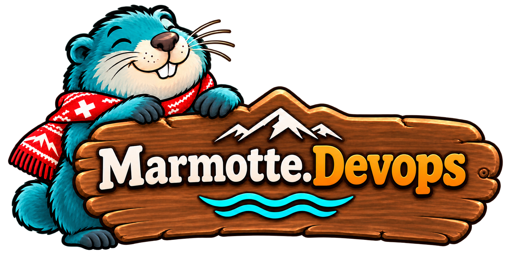

# Image provenance

Marmotte.Devops reuses the visual identity of Marmotte.ChatUi: a turquoise marmot with a cream muzzle, large incisors, and a red scarf with white patterns.

The images are stored here so the README does not depend on externally hosted images.

## Marmotte.Devops banner and logo

Both current assets were created with the built-in imagegen tool and copied into the repository without further image processing. They preserve the mascot's identity, wooden sign, mountain emblem, turquoise decoration, and transparent background, with **Marmotte.Devops** lettering.

| Asset | Content | Use |
| --- | --- | --- |
| [marmotte-devops-banner.png](marmotte-devops-banner.png) | The mascot typing on a laptop with `build.cs` and `deploy.cs` tabs. **Build** shows **Restore → Build → Test → Pack**; **Deploy** shows **SSH** and **WinRM**. | Main project README banner. |
| [marmotte-devops-logo.png](marmotte-devops-logo.png) | The smiling mascot leaning over the Marmotte.Devops wooden sign. | Standalone project logo for documentation and reuse. |

The exact prompts and generation details are recorded in [generation-prompts.md](generation-prompts.md).

## Previous Marmotte.Build artwork

The original artwork was developed in two steps: first adapting the [Marmotte.ChatUi banner reference](references/marmotte-chatui-banner.png) to the Marmotte.Build name, then adding a C# build coding scene.

- [Version 1: Marmotte.Build sign](references/marmotte-build-banner-v1.png) is preserved as the input to the current Marmotte.Devops logo.
- [Version 2: Marmotte.Build coding banner](references/marmotte-build-banner-v2.png) is preserved as the input to the current Marmotte.Devops banner.

These historical references retain their original lettering; current project branding uses the Marmotte.Devops assets above.

## Unmodified source assets

These files were copied without modification from the local Marmotte.ChatUi repository:

| Local asset | Source in Marmotte.ChatUi | Use |
| --- | --- | --- |
| [marmotte-chatui-banner.png](references/marmotte-chatui-banner.png) | `docs/images/marmotte-chatui-banner.png` | Original reference for the Marmotte banner family. |
| [marmotte-mascot.png](marmotte-mascot.png) | `docs/images/marmotte-chatui-mascot.png` | Compact mascot retained for reuse. |
| [experimental-proof-of-concept.png](references/experimental-proof-of-concept.png) | `docs/images/references/experimental-proof-of-concept.png` | Experimental project status. |

The [Marmotte.ChatUi visual identity notes](https://github.com/rflechner/Marmotte.ChatUi/blob/main/docs/images/README.md) record the original references and generation history. According to those notes, the compact mascot was generated from the supplied references using imagegen, and the experimental illustration is an unchanged user-supplied reference originating from [CodeSemantic4Llm](https://github.com/rflechner/CodeSemantic4Llm/blob/main/docs/images/experimental-proof-of-concept.png).

The source assets are retained separately from the generated Marmotte.Devops artwork.
